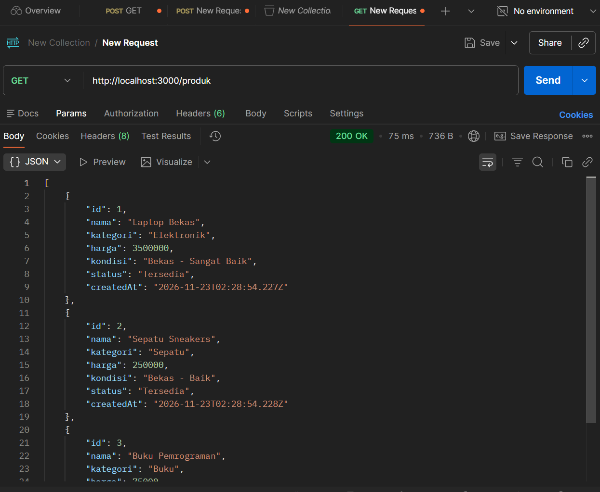
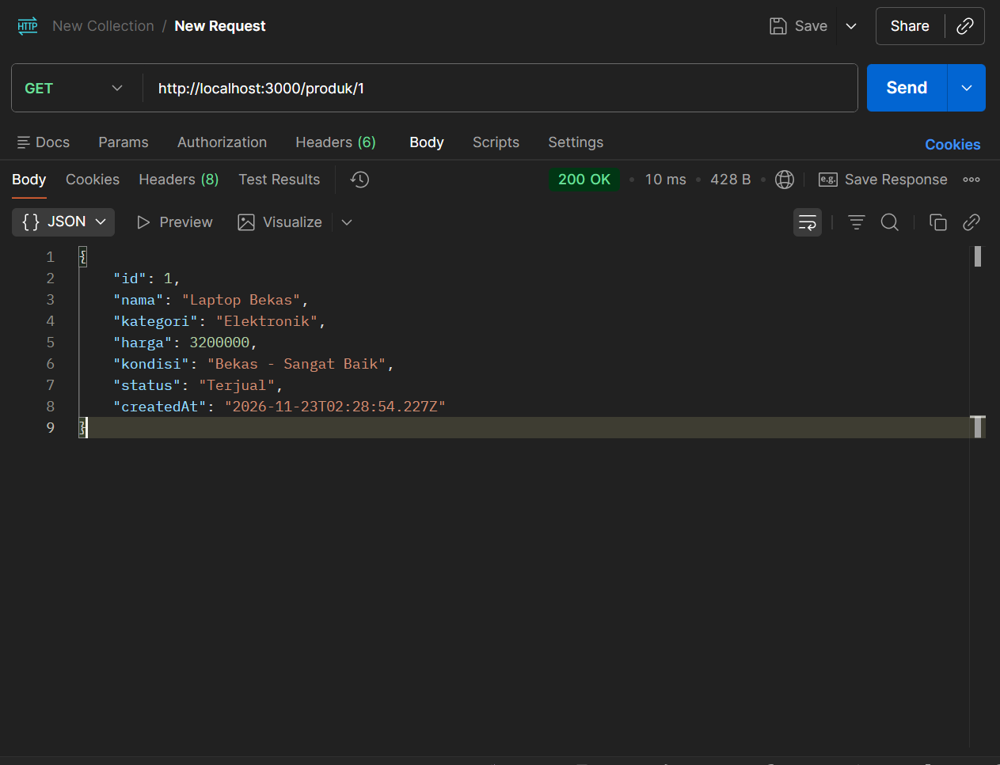
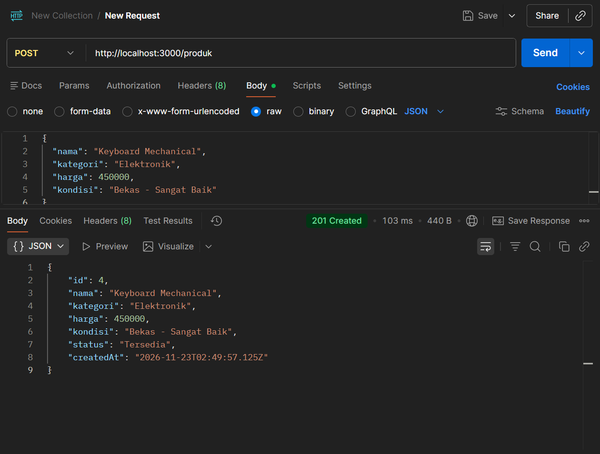
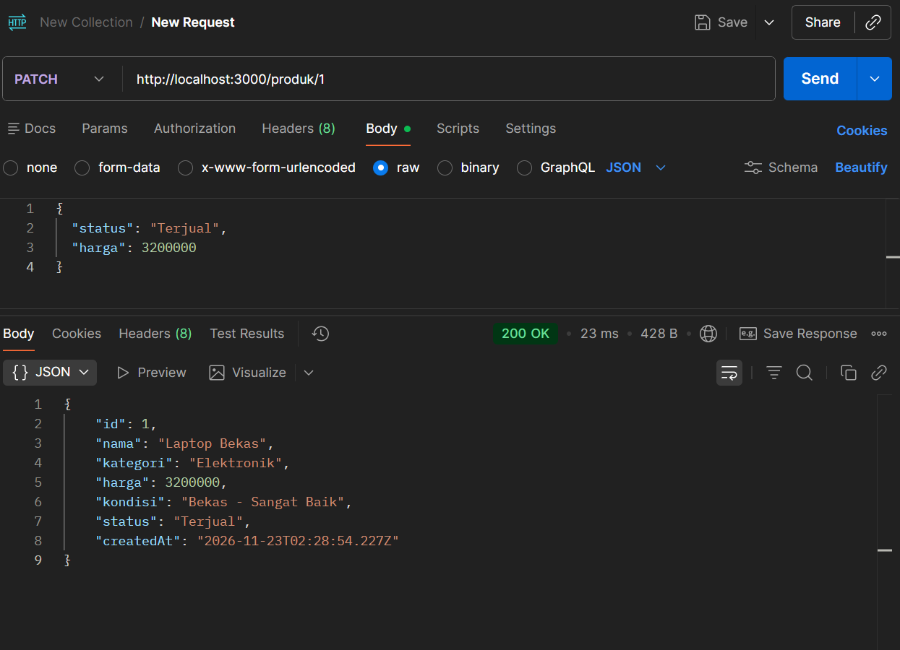
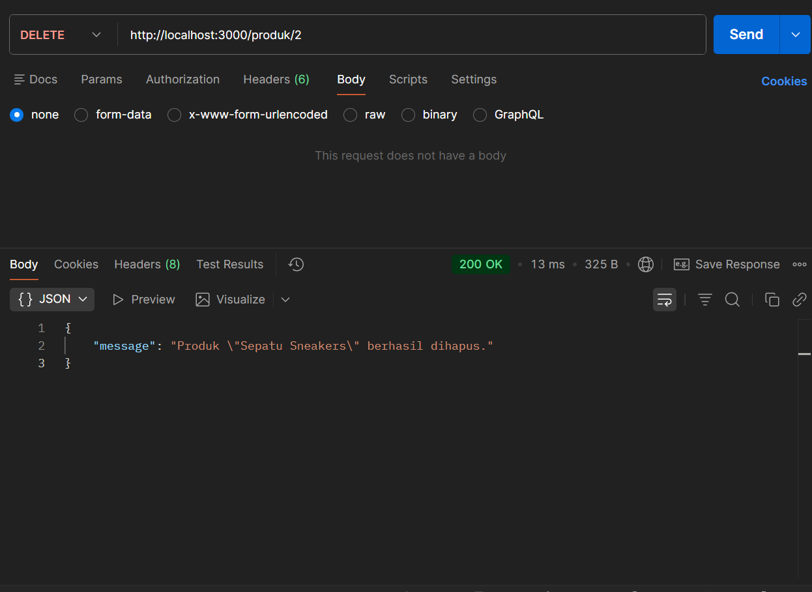
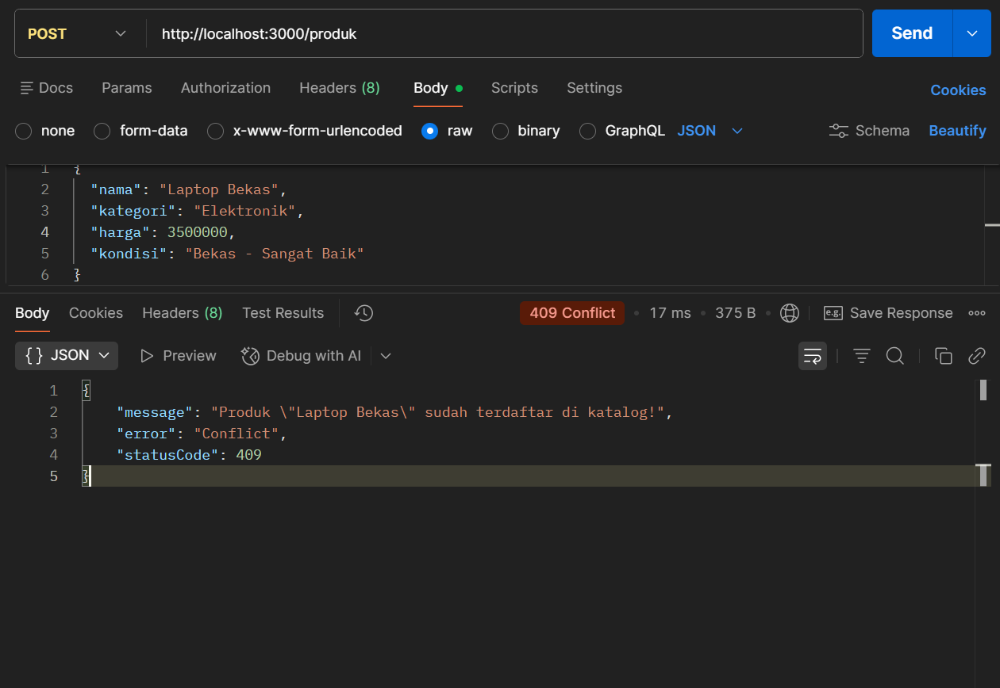

# Secondly — Fullstack Katalog Barang Bekas

Aplikasi fullstack katalog barang bekas menggunakan **React + Vite** (Frontend) dan **NestJS** (Backend REST API).

- **Nama:** Aradea Satria Permana
- **NIM:** 103122400014

## Struktur Proyek
- `secondly-frontend/` — Antarmuka katalog produk (React + Vite)
- `secondly-backend/` — REST API CRUD produk dengan arsitektur MVC, DTO Validation (`class-validator`), dan Exception Handling (`NotFoundException`, `ConflictException`)
- `screenshots/` — Dokumentasi hasil pengujian endpoint REST API

## Cara Menjalankan Aplikasi

### 1. Backend (Port 3000)

    cd secondly-backend
    npm install
    npm run start:dev

### 2. Frontend (Port 5173)

    cd secondly-frontend
    npm install
    npm run dev

## Dokumentasi Pengujian REST API

| Method | Endpoint | Keterangan | Bukti Screenshot |
| :--- | :--- | :--- | :--- |
| `GET` | `/produk` | Menampilkan semua daftar produk |  |
| `GET` | `/produk/:id` | Menampilkan detail satu produk |  |
| `POST` | `/produk` | Menambahkan produk baru |  |
| `PATCH` | `/produk/:id` | Memperbarui data/status produk |  |
| `DELETE` | `/produk/:id` | Menghapus produk |  |
| `POST` | `/produk` | Validasi DTO gagal (`400 Bad Request`) |  |
| `POST` | `/produk` | Data duplikat (`409 Conflict`) |  |
